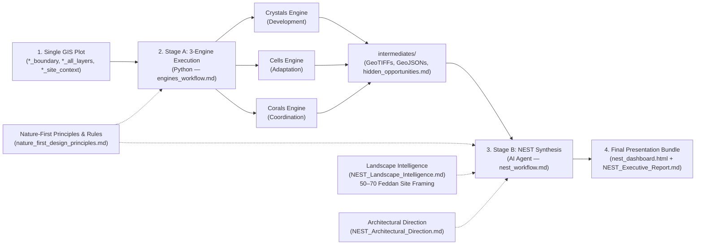

# NEST Master System Architecture & Workflow

> **System Definition:** **NEST** is the overarching system that manages the **3 Engines** (**Crystals**, **Cells**, **Corals**), governing how a GIS plot in Egypt is spatially evaluated, screened, merged, and synthesized into unconventional, site-emergent architectural programs.
>
> **Execution Mode & Scope:** Strictly **autonomous end-to-end** (no human checkpoint between Stage A and Stage B; the user reviews the final presentation bundle) and scoped to **one GIS plot per run** (`1 GIS folder → 1 run_output_dir`; an Egypt-wide regional screener is deferred as a future Stage 0).

---

## 1. System Architecture: NEST ↔ 3 Engines

| Layer | Executor | Reference Document | Ownership & Responsibilities |
| :--- | :--- | :--- | :--- |
| **Engine Identity & Thinking Charter** | Governing Spec (All Stages) | [`engine_charter.md`](./engine_charter.md) | Canonical universal definitions for **Crystals (Development — POIs to build around/in/at)**, **Corals (Coordination — elements working better together / beneficial relationships)**, and **Cells (Adaptation — unlocking an element's potential by adapting it into something new/better)** across land, buildings, skills, and any object. |
| **Design Principles & Rules** | Governing Spec | [`nature_first_design_principles.md`](./nature_first_design_principles.md) | Vision (*Hidden, Potential, Economic Base, Balance with Nature*), Constraints, Knowledge Domains, Analytical Models, Accessibility Scoring, and 3-Tier Operational Rules. |
| **Architectural Direction & Ambition** | Governing Spec (Stage B) | [`NEST_Architectural_Direction.md`](./NEST_Architectural_Direction.md) | **Regenerative Monumentality** thesis, Tiered National Scale Benchmarks (`Tier 1` / `Tier 2`), 4 Mega-National Archetypes, Contemporary Egyptian Monumentality tectonic idioms, 5-Criteria Competition-Grade Impact Rubric (`≥ 75/100`), Global/MENA Precedent Matrix, Egypt Vision 2030 / TSFE funding context, and Hero Render cues. |
| **Landscape Intelligence & Spatial Planning** | Governing Spec (Stage B Step 4A & Stage C Deep-Dive) | [`NEST_Landscape_Intelligence.md`](./NEST_Landscape_Intelligence.md) | Site-led landscape reading, preserve/restore/enhance/activate intervention logic, landscape backbone & destinations, GIS-snapped organic **50–70 feddan (`21.0–29.4 ha`)** boundaries, organic **Landscape Zones** (human-readable names) & area schedules, architecture–landscape interface, and explicit Landscape Trade-Offs & Water/Resource Risk checks (no fixed building-to-landscape ratio). |
| **Experience Architecture & Journey** | Governing Spec (Stage B Step 4C) | [`NEST_Experience_Design.md`](./NEST_Experience_Design.md) | **Remarkable Experience** as the #1 priority outcome (3 Pillars: *Novel & Unprecedented*, *Visually Stunning Architectural Idea*, *Nature as the Hero*), **Architectural & Landscape Ensemble** (Built Elements & Spatial Anchors — Anchor Landmarks + Experience-Curated Dining & Retail + Eco-Accommodation), and a **flexible, project-specific Guest Journey** (`journey[]`, 3–7 bespoke moments). *(3D Rhino massing / clay locks are archived and no longer required.)* |
| **Stage A — 3 Engines** (`Crystals`, `Cells`, `Corals`) | **Python** (`run_3_engines.py`) | [`crystals_nature_forces.md`](./crystals_nature_forces.md), [`cells_nature_forces.md`](./cells_nature_forces.md), [`corals_nature_forces.md`](./corals_nature_forces.md) | Executes GIS spatial masks, classifies every cell as `Dry Land` / `Shoreline Edge (≤100 m)` / `Open Water`, scores the **6 NEST Nature-First Spatial Forces** (*Hydrology & Waterfront*, *Solar & Climate Intensity*, *Biodiversity & Ecology*, *Heritage & Culture Gravity*, *Civic & Service Deficit*, *Corridor & Network Connectivity*) + `Multi-Force Synergy`, extracts observed plot telemetry (real DEM slope, TMY climate, WorldPop, MPED budgets, dataset audit), and exports an **unbiased merit-ranked Top 12–15 `candidate_pool`** (pure spatial peak clusters; zero artificial land/water caps) with `map_feature_pointers` into `intermediates/stage_a_summary.json`. |
| **Stage B — NEST** *(System Manager)* | **AI Agent** | [`nest_workflow.md`](./nest_workflow.md), [`project_brief_template.md`](./project_brief_template.md) | Ingests the audited Top 12–15 `candidate_pool` + `observed_plot_telemetry`, selects the **Final 5 Sites**, defines a **50–70 feddan (`21.0–29.4 ha`)** site boundary around each (documented exception only if hard physical/plot-edge constraints prevent 50 feddans), runs **Landscape-First Site Framing** ([`NEST_Landscape_Intelligence.md`](./NEST_Landscape_Intelligence.md)) → **Integrated Site + Building Co-Synthesis** ([`NEST_Architectural_Direction.md`](./NEST_Architectural_Direction.md)) to test 2–3 integrated hypotheses per site, outputs validated `L-01..L-0N` landscape zone polygons + area schedules, models site-wide financials (splitting **Building CapEx** vs. **Landscape & Site-Infrastructure CapEx**), and assembles `NEST_Executive_Report.md` + `nest_dashboard.html` (NEST 2.2 UI) strictly following [`project_brief_template.md`](./project_brief_template.md). |
| **Stage C — Project Skill Generation, Deep Landscape Masterplan & Detailed Rhino Model** *(On-Demand after Project Selection)* | **AI Agent** + `rhino_massing_engine.py` | [`skill_generation_workflow.md`](./skill_generation_workflow.md), [`skill_defintion.md`](./skill_defintion.md), [`crystal_engine_skill_definition.md`](./crystal_engine_skill_definition.md), [`corals_engine_skill_definition.md`](./corals_engine_skill_definition.md), [`cells_engine_skill_definition.md`](./cells_engine_skill_definition.md), [`NEST_Landscape_Intelligence.md`](./NEST_Landscape_Intelligence.md) | Triggered on demand when the user selects one of the 5 projects from `nest_dashboard.html`. Generates **6–9 site-grounded JSON design skills** (default **9 skills**: `3 Crystals Engine` + `3 Corals Engine` + `3 Cells Engine`, or 6–9 dynamically weighted toward the project's Lead Engine(s)) saved in `<run_output_dir>/skills/project_<rank>_<slug>/` (`*.json` + `SKILL_INDEX.md`) and injected interactively into `nest_dashboard.html`, plus the full **Stage C Deep Landscape Package** per `NEST_Landscape_Intelligence.md` Sections 11 & 15 (8-map PDF set, GeoPackage, QGIS project, CSV/XLSX schedule, and full 12-section landscape report), an upgraded **Stage C Detailed Rhino (`.3dm`) Model** (`--mode detailed` adding floor plates, vertical cores & structural canopy ribs), and an optional interactive WebGL 3D studio HTML. |

---

## 2. End-to-End Execution Flow



### Pipeline Stages
1. **Stage A — 3-Engine Spatial Evaluation (Python):** Run `run_3_engines.py` per [`engines_workflow.md`](./engines_workflow.md) (Stages 1–7), writing all outputs into `<run_output_dir>/intermediates/`.
2. **Stage B — NEST Synthesis & Presentation Assembly (AI Agent):** Automatically ingest `<run_output_dir>/intermediates/` and execute [`nest_workflow.md`](./nest_workflow.md) (Stages 1–6) to produce the final Human-Facing Presentation Bundle at `<run_output_dir>/`.

---

## 3. Rule Precedence (Conflict Resolution Order)

When financial viability and ecological impact collide, NEST and all agents follow this strict hierarchy:

1. **Priority 1 — Financial Feasibility (Hard Gate):** A project must not be financially unfeasible. Financially unfeasible proposals are **hard-rejected**.
2. **Priority 2 — Environmental Harm Flag & Mandatory Nature-Safe Alternative:** If a project achieves financial feasibility *only* by harming or degrading the environment, NEST may still report it—**but MUST clearly flag it as `Harmful to the Environment`** (bold red warning) **and automatically propose a nature-safe feasible alternative** if one exists.
3. **Priority 3 — Nature-Linked Value Optimization:** Among feasible options, prioritize interventions where ecological preservation directly strengthens long-term financial value and reinvests returns into ecological health.

---

## 4. Expected Output Bundle for a Complete NEST Run

Every complete NEST run produces a **Human-Facing Presentation Bundle** at the root of the run output folder, with supporting per-engine GIS artifacts neatly archived under `intermediates/`:

```text
<run_output_dir>/
├── nest_dashboard.html           # 2-Tab Dashboard: Default 'Project Proposals (5 Cards)' + '3-Engine Analysis Maps'
├── NEST_Executive_Report.md      # Executive NEST Report (Top 5 Projects, Spaces/m², Activities, Hypotheses, Financials & Provenance)
├── renders/                      # 5 editorial aerial renders (site_1.jpg .. site_5.jpg) + render_pack/ (satellite_lock + text prompts)
├── skills/                       # Stage C generated project skill bundles (project_<rank>_<slug>/*.json + SKILL_INDEX.md)
├── exports/                      # Self-contained 1-Project Export Folders & .ZIP Packages (project_<rank>_<slug>/ + .zip)
│   └── project_<rank>_<slug>/
│       ├── project_<rank>_dashboard.html  # Standalone 1-Project NEST Dashboard (Brief + Map + Inline Master-Detail Skills)
│       ├── PROJECT_BRIEF.md               # Markdown Project Brief
│       ├── project_data.json              # Full structured project JSON
│       ├── site_geometry.geojson          # Site boundary, landscape zones (L-01..L-0N), built-element footprints & GIS pointers
│       ├── render/                        # site_<rank>.jpg, site_<rank>_satellite_lock.png, site_<rank>_prompt.md
│       └── skills/                        # All generated <skill_id>.json files + SKILL_INDEX.md (or skill_seeds.json)
└── intermediates/                # Supporting per-engine spatial artifacts (generated by Stage A Python)
    ├── engine1_development/      # Crystals GeoTIFFs, GeoJSON, top_site_space_program.md
    ├── engine2_adaptation/       # Cells GeoTIFFs, GeoJSON, top_site_space_program.md
    ├── engine3_coordination/     # Corals GeoTIFFs, GeoJSON, top_site_space_program.md
    ├── hidden_opportunities.md   # Per-engine Nature-First Hidden Potential candidates
    ├── stage_a_summary.json      # Structured Stage A -> Stage B handoff (clusters, polygons, scores, flags)
    └── 3engines_base_dashboard.html
```

### Deliverable Contract

1. **Interactive 2-Tab Dashboard (`nest_dashboard.html`)** — *Card structure, JSON schema, and default **NEST 2.2 warm off-white / dusty-rose / coral + `Funnel Display` UI** strictly governed by [`project_brief_template.md`](./project_brief_template.md) and [`UI Handover/NEST_UI_DESIGN_GUIDE.md`](../UI%20Handover/NEST_UI_DESIGN_GUIDE.md)*
   - **Tab 1 (Default Landing View) — `Project Proposals (5 Cards)`:** Clean gallery of the best **5 NEST Project Cards** (omitting `hidden_score`). Each card displays:
     - **Self-Contained Text + Satellite Render Pack (`renders/render_pack/` — Default, Zero `image-generator` Dependency):** Generated by default using [`GENERAL_KNOWLEDGE/architectural_render_skill/SKILL.md`](./architectural_render_skill/SKILL.md) + `build_render_pack.py`. Packages `site_<N>_satellite_lock.png` (Esri World Imagery crop), `site_<N>_prompt.md` (GIS Site Reality Lock + experience-driven architectural ensemble prompt), `ALL_PROMPTS_CONSOLIDATED.md`, and standalone `AGENT_INSTRUCTIONS.md`. On the dashboard card, the visual header toggles **Editorial Render | Satellite** (`renders/site_<N>.jpg` when present, defaulting to `site_<N>_satellite_lock.png`).
     - **Embedded Mini Interactive Site, Landscape Zoning & Building Footprint Map + Evidence Pointers** using a **Tri-Layer Hierarchy**: (1) the outer **50–70 Feddan Site Boundary** (`21.0–29.4 ha`) shown as a dashed translucent reserve outline (default zoom framed to the full outer site boundary, with zoom controls and scroll-wheel zoom enabled), (2) validated, color-coded **Landscape Zone Polygons (`L-01..L-0N`)** with ID labels and hover tooltips (zone name, family, intervention level, area in `m²` / feddans / `%`), (3) **Concept-Matched Architectural Massing Polygons** inside it as crisp solid polygons scaled accurately to the project's Built GFA (`m²`) and matching its render & parti, with hover tooltips (pavilion name & `m²`), plus **3–5 Numbered GIS Feature Pointer Pins** (`map_pointers[]`, sourced from Stage A `gis_evidence.map_feature_pointers`) with dashed leader lines to the site center, synced with a compact **Site Evidence Highlights** strip below the map, plus a legend and **`3-Engine Map →`** jump button.
     - **Merged Site & Architectural Thesis + Gesture Block** (`thesis_summary`: 1-sentence bold hook + 3 tight bullets `Why Here` / `Key Program` / `Architectural Gesture`, expandable `thesis_detailed` narrative via per-card `View detailed brief ▾` and global `Summary View | Detailed Briefs` switch, plus `Tier 1`/`Tier 2`, Tectonic Idiom, Precedent Lens — *omit competition scores from dashboard*), **Landscape Intelligence & Zoning Schedule (`L-01..L-0N`)** (Landscape Backbone, Architecture–Landscape Interface, validated `m² / ha / feddans / %` zone allocation table reconciling to the 50–70 feddan site, and explicit Landscape Trade-Offs & Water/Resource Risk callout), **How the 3-Engine Heatmaps & Proposals Derived This Result (`engine_trace`)**, **Two-Way Nature Integration Box** (`Nature → Building` + `Building → Nature` — mandatory functional exchange, rejecting cosmetic biomimicry), **Activities**, **Spaces & Square Meters (`m²`) Table**, **Advisory Flags** (`water_zone_warning`, `Harmful to the Environment`, `emergency_access_alert`, `policy_complexity`), **Headline Financial KPIs** (Site-Wide CapEx split into **Building CapEx** + **Landscape & Site-Infrastructure CapEx**, Site-Wide Revenue, ROI, IRR, Payback), and the **Economic Case & Data Sources Block** (Revenue Mix bar/pills covering architecture + landscape streams, 1–2 cited Target Users & Demand Highlights, Target Funding Partners pills, and inline `Observed` vs. `Benchmark` source tags).
     - **Expandable `Hypotheses, Catalytic Phase 0 Pilot & Full Data Provenance` Accordion:** Competing 2–3 integrated Site + Building hypotheses comparison table (each accompanied by its Landscape Trade-Offs & Water/Resource Risk callout), mandatory nature-safe alternative (if triggered), Conservative/Base/Upside scenarios, Catalytic Phase 0 Pilot, and Full Data Provenance badge.
   - **Tab 2 — `3-Engine Analysis Maps`:** Synchronized 3-engine side-by-side spatial heatmaps (**Crystals**, **Cells**, **Corals**) with toggles for the **6 NEST Nature-First Spatial Forces** (`Hydrology & Waterfront`, `Solar & Climate Intensity`, `Biodiversity & Ecology`, `Heritage & Culture Gravity`, `Civic & Service Deficit`, `Corridor & Network Connectivity`) + `Multi-Force Synergy (2+ / 3+)`, reference overlays, NEST Top-5 50–70 feddan site boundary polygons, and an interactive **Cell-Click Inspection Drawer** (`Forces & GIS Drivers` + `Emergent Program & Concept`).

2. **Executive NEST Report (`NEST_Executive_Report.md`)**
   - **Top 5 NEST Sites** per plot, each containing:
     - **Identifiable 50–70 Feddan Boundary & Footprint:** Bounding coordinates, total area in **`m²`, hectares, and Egyptian feddans** (`1 feddan = 4,200.83 m²`, standard target `50–70 feddans` / `21.0–29.4 ha`; documented physical exception required if `< 50 feddans`), and footprint type (`Contiguous` or `Distributed`).
     - **Cross-Engine Rationale:** Crystals / Cells / Corals scores, `Select` vs. `Merge` decision, and Nature-First 2.5 km Hidden Potential provenance.
     - **Landscape Intelligence & Zoning Schedule (`L-01..L-0N`):** Landscape Backbone, preserve/restore/enhance/activate strategy, Architecture–Landscape Interface, reconciled zone area schedule (`m²`, `ha`, `feddans`, `%`), and explicit Landscape Trade-Offs & Water/Resource Risk callout.
     - **Multi-Hypothesis Integrated Site + Building Comparison:** Table comparing **2–3 competing integrated Site + Building hypotheses**, the **selected winner** with rationale (including **Signature Architectural Gesture**, `Tier 1`/`Tier 2` National Scale, **≥ 75/100** Competition-Grade Impact Rubric breakdown + visible Landscape Trade-Offs & Water/Resource Risk callout, and Precedent Lens per [`NEST_Architectural_Direction.md`](./NEST_Architectural_Direction.md)), and a **mandatory nature-safe feasible alternative** whenever `Harmful to the Environment` is triggered.
     - **Advisory & Environmental Flags:** Explicit badges for `water_zone_warning`, `Harmful to the Environment`, `emergency_access_alert`, and `policy_complexity`, plus NEST Accessibility score (`High = 100`, `Moderate = 50`, `Low = 15`).
     - **Compact Financial Summary Table:** Total Site CapEx (**Building CapEx** + **Landscape & Site-Infrastructure CapEx**), Expected Annual Site-Wide Revenue, EBITDA/Profit, ROI, IRR, Payback Period, Conservative/Base/Upside scenario range, **Pilot-Scale Test** cost & timeline, and a mandatory **Data Provenance Badge** (`% Observed vs. Estimated` + exact benchmark/calculation source).
